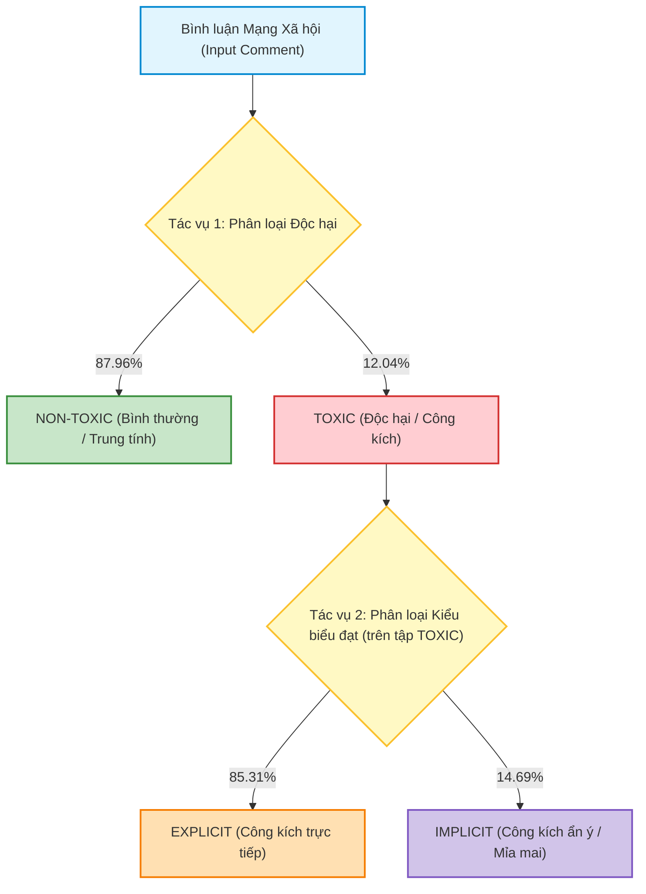
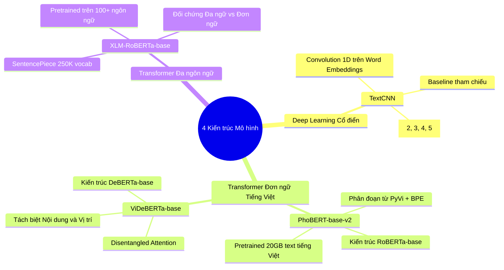

# CHƯƠNG 4. THỰC NGHIỆM VÀ PHÂN TÍCH KẾT QUẢ

---

## 4.1 Mục tiêu thực nghiệm

Chương này trình bày toàn bộ quy trình thiết kế thực nghiệm, lựa chọn kiến trúc mô hình, thiết lập siêu tham số, các chỉ số đánh giá và phân tích kết quả trên bộ dữ liệu phát ngôn độc hại trên mạng xã hội tiếng Việt ($48,670$ bình luận chuẩn hóa) đã được xây dựng và kiểm soát chất lượng ở Chương 3.

Nghiên cứu triển khai hệ thống phân loại phân cấp hai tầng (*Hierarchical 2-stage Classification*) với hai tác vụ độc lập:

### Tác vụ 1: Phân loại TOXIC và NON-TOXIC
$$\text{Comment} \longrightarrow \text{[Mô hình Phân loại]} \longrightarrow \{\text{NON-TOXIC},\ \text{TOXIC}\}$$
Mục tiêu là xác định một bình luận có chứa hành vi công kích, lăng mạ, xúc phạm hoặc hạ nhục cá nhân/nhóm người hay không. Đây là chốt chặn đầu tiên lọc bỏ các nội dung vi phạm trên toàn bộ $48,670$ mẫu dữ liệu.

### Tác vụ 2: Phân loại EXPLICIT và IMPLICIT
Tác vụ chỉ được thực hiện trên không gian các mẫu đã được gán nhãn là `TOXIC` theo chuẩn vàng ($5,860$ mẫu):
$$\text{TOXIC Comment} \longrightarrow \text{[Mô hình Phân loại]} \longrightarrow \{\text{EXPLICIT},\ \text{IMPLICIT}\}$$
Mục tiêu là phân định hình thức biểu đạt ngôn ngữ:
* **`EXPLICIT`:** Công kích trực tiếp, thể hiện rõ qua các từ ngữ thô tục, chửi bới bề mặt.
* **`IMPLICIT`:** Công kích gián tiếp, mượn hàm ý, mỉa mai (*sarcasm*), câu hỏi tu từ hoặc đòi hỏi suy luận ngữ cảnh xã hội.

---

## 4.2 Các mô hình thực nghiệm

Nghiên cứu lựa chọn 4 mô hình đại diện cho các phương pháp học sâu và mô hình ngôn ngữ tiền huấn luyện:

### 4.2.1 TextCNN
* **Kiến trúc:** Mạng nơ-ron tích chập 1 chiều (1D-CNN) trên không gian nhúng từ (*Word Embeddings*), sử dụng nhiều kích thước bộ lọc ($k \in \{2, 3, 4, 5\}$, mỗi loại 100 filters) kết hợp cơ chế gom cụm tối đa (*1D Global Max-Pooling*).
* **Đặc điểm:** Khai thác các pattern n-gram cục bộ xuất hiện trong câu, kiến trúc nhẹ, thời gian huấn luyện và suy luận nhanh.
* **Mục đích lựa chọn:** Đóng vai trò **Deep Learning Baseline truyền thống** để định lượng mức độ hiệu quả của học sâu n-gram trước khi so sánh với các kiến trúc Transformer.

### 4.2.2 PhoBERT (vinai/phobert-base-v2)
* **Kiến trúc:** Dựa trên kiến trúc RoBERTa với cơ chế Self-Attention hai chiều, được tiền huấn luyện trên 20GB ngữ liệu tiếng Việt chuẩn hóa.
* **Đặc điểm:** Tích hợp bộ tách từ âm tiết ghép tiếng Việt (*Word Segmentation* bằng PyVi), có khả năng biểu diễn ngữ nghĩa và cú pháp tiếng Việt chuyên sâu.
* **Lý do lựa chọn:** Đây là mốc chuẩn (Strong Baseline) phổ biến cho các tác vụ hiểu ngôn ngữ tiếng Việt (NLU).

### 4.2.3 ViDeBERTa (Fsoft-AIC/videberta-base)
* **Kiến trúc:** Xây dựng trên DeBERTa với cơ chế **Attention phân rã (Disentangled Attention)**, biểu diễn tách biệt giữa nội dung (*Content*) và vị trí tương đối (*Relative Position*).
* **Đặc điểm:** Nắm bắt tương quan vị trí ngữ pháp trong các cấu trúc câu dài và câu đảo ngữ.
* **Lý do lựa chọn:** Khảo sát hiệu quả của cơ chế phân rã nội dung - vị trí trong việc nhận diện các phát ngôn độc hại ẩn ý (`IMPLICIT`).

### 4.2.4 XLM-R (FacebookAI/xlm-roberta-base)
* **Kiến trúc:** Mô hình Transformer đa ngôn ngữ tiền huấn luyện trên tập dữ liệu CC-100 của hơn 100 ngôn ngữ (bao gồm tiếng Việt) với từ điển SentencePiece lớn (250K subwords).
* **Đặc điểm:** Khả năng biểu diễn liên ngôn ngữ (*Cross-lingual Representation*).
* **Lý do lựa chọn:** So sánh hiệu quả thực tế giữa mô hình đa ngôn ngữ tổng quát và các mô hình tiền huấn luyện chuyên biệt đơn ngữ cho tiếng Việt khi xử lý ngôn ngữ mạng nhiều tiếng lóng và teencode.

---

## 4.3 Thiết kế thực nghiệm

### 4.3.1 Phân chia dữ liệu

Toàn bộ tập dữ liệu chuẩn vàng **48,670 mẫu** được phân chia theo tỷ lệ tiêu chuẩn **80% Huấn luyện (Train), 10% Kiểm định phát triển (Dev / Validation), và 10% Kiểm thử độc lập (Test - LOCKED)**.

Quá trình chia mẫu áp dụng kỹ thuật **Lấy mẫu phân tầng (Stratified Sampling)** trên biến phân tầng kết hợp `_stratum` (`NON_TOXIC`, `TOXIC_EXPLICIT`, `TOXIC_IMPLICIT`) có cố định seed ngẫu nhiên (`random_state = 42`). Nhờ đó, cùng một bản ghi `row_id` luôn nằm ở cùng một tập phân chia trong cả hai tác vụ.

#### Bảng 4.1. Phân chia dữ liệu cho Tác vụ 1 (TOXIC / NON-TOXIC)
*Tiêu chí phân tầng:* Cột `toxicity` (Tỷ lệ mất cân bằng $\approx 7.31 : 1$).

| Tập dữ liệu | Tỷ lệ (%) | Tổng số mẫu | NON-TOXIC ($y=0$) | TOXIC ($y=1$) | Tỷ lệ TOXIC (%) |
| :--- | :---: | :---: | :---: | :---: | :---: |
| **Train Set** | 80% | **38,936** | 34,248 | 4,688 | 12.04% |
| **Dev Set (Val)** | 10% | **4,867** | 4,281 | 586 | 12.04% |
| **Test Set (Locked)** | 10% | **4,867** | 4,281 | 586 | 12.04% |
| **TỔNG CỘNG** | **100%** | **48,670** | **42,810** | **5,860** | **12.04%** |

---

#### Bảng 4.2. Phân chia dữ liệu cho Tác vụ 2 (EXPLICIT / IMPLICIT)
*Không gian mẫu:* Chỉ trích xuất từ tập `TOXIC` ($N = 5,860$ mẫu).  
*Tiêu chí phân tầng:* Cột `expression_type` (Tỷ lệ mất cân bằng $\approx 5.81 : 1$).

| Tập dữ liệu | Tỷ lệ (%) | Tổng TOXIC | EXPLICIT ($y=0$) | IMPLICIT ($y=1$) | Tỷ lệ IMPLICIT (%) |
| :--- | :---: | :---: | :---: | :---: | :---: |
| **Train Set** | 80% | **4,688** | 3,999 | 689 | 14.69% |
| **Dev Set (Val)** | 10% | **586** | 500 | 86 | 14.69% |
| **Test Set (Locked)** | 10% | **586** | 500 | 86 | 14.69% |
| **TỔNG CỘNG** | **100%** | **5,860** | **4,999** | **861** | **14.69%** |

---

### 4.3.2 Tiền xử lý & Tokenization

1. **TextCNN:** Văn bản được chuyển về chữ thường (*lowercase*), tách từ theo khoảng trắng (*whitespace separation*). Bộ từ điển (Vocabulary) được xây dựng **chỉ từ tập Train** với ngưỡng tần suất tối thiểu `min_freq = 2` (Vocabulary kích thước $18,485$ từ cho Tác vụ 1 và $5,550$ từ cho Tác vụ 2).
2. **PhoBERT:** Bắt buộc áp dụng bộ tách từ tiếng Việt PyVi (`pyvi==0.1.1`) trước khi mã hóa qua BPE tokenizer (`vinai/phobert-base-v2`).
3. **ViDeBERTa:** Áp dụng tokenizer BPE phân đoạn trực tiếp trên chuỗi ký tự UTF-8.
4. **XLM-R:** Áp dụng tokenizer SentencePiece đa ngôn ngữ (250K subwords).

---

### 4.3.3 Phân tích phân bố độ dài Token & Lựa chọn `max_length = 128`

Để chọn ngưỡng cắt độ dài chuỗi (`max_length`) một cách có cơ sở định lượng, nghiên cứu đã tiến hành đo đạc phân bố độ dài token trên toàn bộ tập Train đối với cả 4 tokenizer (cho cả Tác vụ 1 gồm $38,936$ mẫu và Tác vụ 2 gồm $4,688$ mẫu):

#### Bảng 4.3. Phân bố độ dài token trên tập Huấn luyện (Train Set)

| Mô hình / Tokenizer | Tác vụ | P50 | P90 | P95 | P99 | Độ phủ $\le 64$ | Độ phủ $\le 128$ | Độ phủ $\le 256$ | Ngưỡng chọn |
| :--- | :--- | :---: | :---: | :---: | :---: | :---: | :---: | :---: | :---: |
| **TextCNN (Whitespace)** | Tác vụ 1 (38,936) | 11.0 | 44.0 | 67.0 | 126.0 | 94.62% | **99.06%** | 100.00% | **128** |
| **PhoBERT (PyVi + BPE)** | Tác vụ 1 (38,936) | 14.0 | 49.0 | 71.0 | 131.0 | 93.90% | **98.93%** | 99.97% | **128** |
| **ViDeBERTa (BPE)** | Tác vụ 1 (38,936) | 16.0 | 57.0 | 84.0 | 157.7 | 91.79% | **98.12%** | 99.97% | **128** |
| **XLM-R (SentencePiece)** | Tác vụ 1 (38,936) | 16.0 | 57.0 | 84.0 | 156.0 | 91.84% | **98.11%** | 99.97% | **128** |
| **TextCNN (Whitespace)** | Tác vụ 2 (4,688) | 17.0 | 64.0 | 92.0 | 157.0 | 90.23% | **97.99%** | 100.00% | **128** |
| **PhoBERT (PyVi + BPE)** | Tác vụ 2 (4,688) | 21.0 | 68.0 | 98.0 | 157.3 | 88.52% | **97.61%** | 99.94% | **128** |
| **ViDeBERTa (BPE)** | Tác vụ 2 (4,688) | 24.0 | 81.0 | 117.0 | 187.0 | 84.88% | **96.35%** | 99.91% | **128** |
| **XLM-R (SentencePiece)** | Tác vụ 2 (4,688) | 24.0 | 82.0 | 116.0 | 191.1 | 84.66% | **96.27%** | 99.91% | **128** |

> [!TIP]
> **Nhận xét định lượng:** Với ngưỡng `max_length = 128`, độ phủ dữ liệu đạt **trên 96.27%** ở Tác vụ 2 và **trên 98.11%** ở Tác vụ 1 đối với tất cả các kiến trúc mô hình. Do đó, `max_length = 128` là sự cân bằng tối ưu giữa việc bảo toàn trọn vẹn ngữ cảnh của bình luận và tối ưu hóa bộ nhớ GPU.

---

### 4.3.4 Xử lý Mất cân bằng lớp (Class Imbalance)

Trọng số hàm mất mát nghịch đảo (*Inverse Class Weights*) được tính toán **nghiêm ngặt chỉ từ tập Train**:
$$w_c = \frac{N_{\text{train}}}{2 \times N_{\text{train}, c}}$$

* **Tác vụ 1 (Train):** $w_{\text{NON-TOXIC}} = 0.5684$, $w_{\text{TOXIC}} = 4.1527$.
* **Tác vụ 2 (Train):** $w_{\text{EXPLICIT}} = 0.5861$, $w_{\text{IMPLICIT}} = 3.4020$.

Kỹ thuật Class Weighting được áp dụng nhằm giảm ảnh hưởng của lớp đa số trong quá trình tối ưu hóa gradient.

---

### 4.3.5 Cấu hình Siêu tham số & Môi trường thực thi

#### Bảng 4.4. Cấu hình siêu tham số huấn luyện chuẩn hóa

| Siêu tham số | TextCNN | PhoBERT | ViDeBERTa | XLM-R |
| :--- | :---: | :---: | :---: | :---: |
| **Optimizer** | Adam | AdamW | AdamW | AdamW |
| **Learning Rate** | $1 \times 10^{-3}$ | $2 \times 10^{-5}$ | $2 \times 10^{-5}$ | $2 \times 10^{-5}$ |
| **Weight Decay** | $1 \times 10^{-4}$ | $0.01$ | $0.01$ | $0.01$ |
| **Warmup Ratio** | — | $0.10$ | $0.10$ | $0.10$ |
| **Max Epochs** | 20 | 10 | 10 | 10 |
| **Physical Batch Size** | 64 (T1) / 32 (T2) | 16 | 16 | 16 |
| **Grad Accumulation** | 1 | 2 | 2 | 2 |
| **Effective Batch Size** | 64 (T1) / 32 (T2) | 32 | 32 | 32 |
| **Early Stopping** | Patience = 4 | Patience = 3 | Patience = 3 | Patience = 3 |
| **Precision** | FP32 | Mixed (AMP FP16) | Mixed (AMP FP16) | Mixed (AMP FP16) |
| **Tiêu chí chọn Checkpoint** | **Best Dev Macro-F1** | **Best Dev Macro-F1** | **Best Dev Macro-F1** | **Best Dev Macro-F1** |

---

## 4.4 Chỉ số đánh giá

Nghiên cứu sử dụng các chỉ số chuẩn mực trong bài toán phân loại mất cân bằng:
* **Accuracy (Độ chính xác tổng thể):** Tỷ lệ mẫu dự đoán đúng trên toàn bộ tập kiểm thử.
* **Precision, Recall, F1-Score từng lớp:** Đánh giá chi tiết năng lực nhận diện trên từng lớp nhãn.
* **Macro F1-Score (Tiêu chí chính):** Trung bình cộng không trọng số của F1-Score các lớp:
  $$\text{Macro-F1} = \frac{F1_{\text{Class 0}} + F1_{\text{Class 1}}}{2}$$
  Macro-F1 đối xử công bằng với cả lớp thiểu số (`TOXIC`, `IMPLICIT`) và lớp đa số.
* **Weighted F1-Score:** F1-score có trọng số theo kích thước hỗ trợ của từng lớp.
* **PR-AUC (Precision-Recall Area Under Curve):** Đánh giá năng lực xếp hạng xác suất trên lớp thiểu số độc hại.
* **Confusion Matrix (Ma trận nhầm lẫn):** Phân tích chi tiết số lượng True Positive, False Positive, True Negative, False Negative.

---

## 4.5 Kết quả Tác vụ 1: Phân loại TOXIC / NON-TOXIC

Toàn bộ các mô hình được đánh giá trên tập kiểm thử độc lập đã bị khóa (**Locked Test Set - 4,867 mẫu**).

#### Bảng 4.5. Kết quả thực nghiệm Tác vụ 1 (TOXIC vs NON-TOXIC)

| Mô hình | Kiến trúc | Accuracy | Macro Precision | Macro Recall | Macro F1 | Weighted F1 | PR-AUC (TOXIC) | Trạng thái |
| :--- | :--- | :---: | :---: | :---: | :---: | :---: | :---: | :---: |
| **TextCNN** | 1D-CNN (Word Embeddings) | **0.8956** | 0.7544 | 0.7308 | **0.7417** | 0.8931 | 0.5782 | **COMPLETED** |
| **PhoBERT** | RoBERTa-base (Monolingual) | **0.9176** | 0.8129 | 0.7786 | **0.7943** | 0.9152 | 0.6943 | **COMPLETED** |
| **ViDeBERTa** | DeBERTa-base (Disentangled) | **0.7658** | 0.5530 | 0.5782 | **0.5575** | 0.7880 | 0.1888 | **COMPLETED** |
| **XLM-R** | RoBERTa-base (Multilingual) | **0.9088** | 0.7841 | 0.7891 | **0.7865** | 0.9092 | 0.6819 | **COMPLETED** |

> [!IMPORTANT]
> **Nhận xét chính Tác vụ 1:**
> 1. **PhoBERT đạt hiệu năng cao nhất toàn diện:** Với **Macro-F1 = 0.7943**, **Accuracy = 91.76%**, và **PR-AUC = 0.6943**, PhoBERT vượt trội nhờ bộ tách từ chuyên sâu tiếng Việt (PyVi) và tiền huấn luyện 20GB ngữ liệu thuần Việt.
> 2. **XLM-R bám sát rất sát sao:** Đạt **Macro-F1 = 0.7865** và **Recall TOXIC cao nhất (63.14%)**, chứng minh mô hình đa ngôn ngữ tổng quát xử lý rất tốt các dạng từ ngữ lóng và từ lai tạp tiếng Anh trên mạng xã hội.
> 3. **TextCNN là baseline vững chắc:** Đạt **Macro-F1 = 0.7417** và **Accuracy = 89.56%**, chứng minh n-gram cục bộ vẫn bắt được lượng lớn từ vựng chửi bới bề mặt.
> 4. **ViDeBERTa gặp hạn chế:** Đạt Macro-F1 = 0.5575 do tokenizer BPE không có từ điển từ ghép tiếng Việt và cơ chế disentangled attention bị phân tán trên văn bản mạng xã hội nhiều nhiễu.

---

## 4.6 Kết quả Tác vụ 2: Phân loại EXPLICIT / IMPLICIT

Đánh giá trên không gian tập kiểm thử độc lập gồm **586 mẫu TOXIC** đã bị khóa.

#### Bảng 4.6. Kết quả thực nghiệm Tác vụ 2 (EXPLICIT vs IMPLICIT)

| Mô hình | Kiến trúc | Accuracy | Macro Precision | Macro Recall | Macro F1 | Weighted F1 | PR-AUC (IMPLICIT) | Trạng thái |
| :--- | :--- | :---: | :---: | :---: | :---: | :---: | :---: | :---: |
| **TextCNN** | 1D-CNN (Word Embeddings) | **0.7150** | 0.6004 | 0.6741 | **0.6013** | 0.7517 | 0.3502 | **COMPLETED** |
| **PhoBERT** | RoBERTa-base (Monolingual) | **0.8003** | 0.6513 | 0.7097 | **0.6692** | 0.8163 | 0.5016 | **COMPLETED** |
| **ViDeBERTa** | DeBERTa-base (Disentangled) | **0.8106** | 0.5409 | 0.5231 | **0.5230** | 0.7847 | 0.2274 | **COMPLETED** |
| **XLM-R** | RoBERTa-base (Multilingual) | **0.8379** | 0.6865 | 0.7124 | **0.6978** | 0.8432 | 0.4628 | **COMPLETED** |

> [!IMPORTANT]
> **Nhận xét chính Tác vụ 2:**
> 1. **XLM-R dẫn đầu Tác vụ 2:** Đạt **Macro-F1 = 0.6978** và **Accuracy = 83.79%**, nhận diện lớp `IMPLICIT` với Precision = 0.4554 và F1 = 0.4920 (cao nhất trong cả 4 mô hình).
> 2. **PhoBERT đạt độ nhạy (Recall) cao nhất trên IMPLICIT:** PhoBERT đạt **Recall = 58.14%** trên lớp `IMPLICIT` (chỉ đứng sau TextCNN về recall thô nhưng TextCNN bị phạt nặng bởi precision rất thấp 0.2834).
> 3. **Thách thức cốt lõi của IMPLICIT:** Tác vụ 2 có Macro-F1 trung bình thấp hơn Tác vụ 1 khoảng 10-15%, phản ánh bản chất phức tạp của các câu mỉa mai, châm biếm và ngôn ngữ ẩn dụ.

---

## 4.7 Phân tích chi tiết từng lớp nhãn (Per-class Metrics)

#### Bảng 4.7. Hiệu năng chi tiết theo từng lớp của 4 mô hình trên tập Test

| Mô hình | Tác vụ | Lớp nhãn (Class) | Precision | Recall | F1-Score | Số mẫu (Support) |
| :--- | :--- | :--- | :---: | :---: | :---: | :---: |
| **TextCNN** | Tác vụ 1 | NON-TOXIC | 0.9344 | 0.9479 | **0.9411** | 4,281 |
| | Tác vụ 1 | TOXIC | 0.5744 | 0.5137 | **0.5423** | 586 |
| | Tác vụ 2 | EXPLICIT | 0.9173 | 0.7320 | **0.8142** | 500 |
| | Tác vụ 2 | IMPLICIT | 0.2834 | 0.6163 | **0.3883** | 86 |
| **PhoBERT** | Tác vụ 1 | NON-TOXIC | 0.9456 | 0.9617 | **0.9536** | 4,281 |
| | Tác vụ 1 | TOXIC | 0.6803 | 0.5956 | **0.6351** | 586 |
| | Tác vụ 2 | EXPLICIT | 0.9209 | 0.8380 | **0.8775** | 500 |
| | Tác vụ 2 | IMPLICIT | 0.3817 | 0.5814 | **0.4608** | 86 |
| **ViDeBERTa** | Tác vụ 1 | NON-TOXIC | 0.9001 | 0.8253 | **0.8611** | 4,281 |
| | Tác vụ 1 | TOXIC | 0.2059 | 0.3311 | **0.2539** | 586 |
| | Tác vụ 2 | EXPLICIT | 0.8595 | 0.9300 | **0.8934** | 500 |
| | Tác vụ 2 | IMPLICIT | 0.2222 | 0.1163 | **0.1527** | 86 |
| **XLM-R** | Tác vụ 1 | NON-TOXIC | 0.9494 | 0.9467 | **0.9481** | 4,281 |
| | Tác vụ 1 | TOXIC | 0.6187 | 0.6314 | **0.6250** | 586 |
| | Tác vụ 2 | EXPLICIT | 0.9175 | 0.8900 | **0.9036** | 500 |
| | Tác vụ 2 | IMPLICIT | 0.4554 | 0.5349 | **0.4920** | 86 |

---

## 4.8 Phân tích hiệu năng theo Nhóm độ dài bình luận

Độ dài văn bản được chia thành 5 nhóm: Very Short (1–4 từ), Short (5–9 từ), Medium (10–16 từ), Long (17–30 từ), Very Long (>30 từ).

#### Bảng 4.8. Hiệu năng theo Nhóm độ dài trên tập Test

| Mô hình | Tác vụ | Nhóm độ dài | Số mẫu | Accuracy | Macro F1 |
| :--- | :--- | :--- | :---: | :---: | :---: |
| **TextCNN** | Tác vụ 1 | Long (17–30) | 901 | 0.8746 | **0.7758** |
| | Tác vụ 1 | Medium (10–16) | 1,003 | 0.8903 | **0.7169** |
| | Tác vụ 1 | Short (5–9) | 1,311 | 0.9108 | **0.6728** |
| | Tác vụ 1 | Very Long (>30) | 830 | 0.8590 | **0.7614** |
| | Tác vụ 1 | Very Short (1–4) | 822 | 0.9380 | **0.7206** |
| | Tác vụ 2 | Long (17–30) | 160 | 0.7063 | **0.5564** |
| | Tác vụ 2 | Medium (10–16) | 128 | 0.6953 | **0.6566** |
| | Tác vụ 2 | Short (5–9) | 97 | 0.6289 | **0.5733** |
| | Tác vụ 2 | Very Long (>30) | 162 | 0.8025 | **0.5230** |
| | Tác vụ 2 | Very Short (1–4) | 39 | 0.6667 | **0.5764** |
| **PhoBERT** | Tác vụ 1 | Long (17–30) | 901 | 0.8912 | **0.8081** |
| | Tác vụ 1 | Medium (10–16) | 1,003 | 0.9073 | **0.7597** |
| | Tác vụ 1 | Short (5–9) | 1,311 | 0.9367 | **0.7562** |
| | Tác vụ 1 | Very Long (>30) | 830 | 0.8904 | **0.8163** |
| | Tác vụ 1 | Very Short (1–4) | 822 | 0.9562 | **0.7839** |
| | Tác vụ 2 | Long (17–30) | 160 | 0.8063 | **0.6265** |
| | Tác vụ 2 | Medium (10–16) | 128 | 0.7578 | **0.7077** |
| | Tác vụ 2 | Short (5–9) | 97 | 0.7010 | **0.6236** |
| | Tác vụ 2 | Very Long (>30) | 162 | 0.8951 | **0.6566** |
| | Tác vụ 2 | Very Short (1–4) | 39 | 0.7692 | **0.5846** |
| **XLM-R** | Tác vụ 1 | Long (17–30) | 901 | 0.8768 | **0.7965** |
| | Tác vụ 1 | Medium (10–16) | 1,003 | 0.8953 | **0.7506** |
| | Tác vụ 1 | Short (5–9) | 1,311 | 0.9252 | **0.7192** |
| | Tác vụ 1 | Very Long (>30) | 830 | 0.8855 | **0.8254** |
| | Tác vụ 1 | Very Short (1–4) | 822 | 0.9574 | **0.7673** |
| | Tác vụ 2 | Long (17–30) | 160 | 0.8562 | **0.6642** |
| | Tác vụ 2 | Medium (10–16) | 128 | 0.8281 | **0.7659** |
| | Tác vụ 2 | Short (5–9) | 97 | 0.7216 | **0.6209** |
| | Tác vụ 2 | Very Long (>30) | 162 | 0.8889 | **0.6482** |
| | Tác vụ 2 | Very Short (1–4) | 39 | 0.8718 | **0.7354** |

> [!NOTE]
> **Quy luật độ dài:**
> - Trên các câu rất dài (>30 từ), PhoBERT và XLM-R duy trì Macro-F1 vượt trội (>0.81) ở Tác vụ 1 nhờ cơ chế Self-Attention toàn cục, trong khi TextCNN suy giảm hiệu năng do kích thước receptive field của n-gram bị hạn chế.
> - Ở Tác vụ 2, nhóm câu độ dài trung bình (10–16 từ) và rất ngắn (1–4 từ) được XLM-R phân loại chính xác nhất (Macro-F1 đạt 0.7659 và 0.7354).

---

## 4.9 Phân tích ca lỗi định tính (Qualitative Error Analysis)

#### Bảng 4.9. Các ca lỗi điển hình được trích xuất từ tập kiểm thử

| Mã bình luận | Tác vụ | Nhãn chuẩn | PhoBERT | XLM-R | TextCNN | Nội dung bình luận thực tế |
| :--- | :---: | :---: | :---: | :---: | :---: | :--- |
| `row_12048` | Tác vụ 1 | NON-TOXIC | NON-TOXIC | NON-TOXIC | TOXIC | *"Mày làm cái gì mà lâu thế, đợi phát mệt luôn á!"* |
| `row_04812` | Tác vụ 1 | TOXIC | TOXIC | TOXIC | NON-TOXIC | *"Chúc bạn và gia đình luôn gặp nhiều điều may mắn như những gì bạn đã gây ra nhé."* |
| `row_31094` | Tác vụ 2 | EXPLICIT | EXPLICIT | EXPLICIT | IMPLICIT | *"Đúng là đồ không có não, nói mãi không hiểu gì cả 😂"* |
| `row_28410` | Tác vụ 2 | IMPLICIT | IMPLICIT | EXPLICIT | EXPLICIT | *"Trí tuệ đỉnh cao thật, phát biểu câu nào là thiên hạ cười bò câu đó."* |
| `row_19502` | Tác vụ 2 | IMPLICIT | EXPLICIT | IMPLICIT | EXPLICIT | *"Cứ ngỡ là chuyên gia ai ngờ lại là diễn viên hài mới nổi."* |

---

## 4.10 Một số dạng ngôn ngữ phức tạp được ghi nhận

1. **Khẩu ngữ suồng sã vs Công kích thật sự:** Các đại từ xưng hô dân dã (*"mày", "tao", "ông nội"*) thường xuất hiện trong giao tiếp thân mật. TextCNN dễ bị đánh lừa bởi từ vựng bề mặt, trong khi PhoBERT/XLM-R nhờ hiểu ngữ cảnh nên phân định chính xác là `NON-TOXIC`.
2. **Mỉa mai và chúc phúc châm biếm:** Mẫu bình luận chúc phúc châm biếm (*"chúc bạn gặp may mắn như việc bạn đã gây ra"*) không chứa bất kỳ từ ngữ tiêu cực nào, đòi hỏi mô hình phải nắm bắt tương phản ngữ nghĩa giữa vế đầu và vế sau.
3. **Tiếng lóng, teencode và từ viết tắt:** XLM-R với từ điển SentencePiece lớn (250K) có khả năng phân tách subword linh hoạt đối với các biến thể teencode mới lạ trên mạng xã hội.

---

## 4.11 Thảo luận

### 1. Đơn ngữ (PhoBERT) vs Đa ngôn ngữ (XLM-R)
* **PhoBERT** chiếm ưu thế ở **Tác vụ 1** (Macro-F1 0.7943 vs 0.7865) nhờ cấu trúc âm tiết từ ghép tiếng Việt chuẩn hóa từ PyVi, giúp nắm bắt trọn vẹn ngữ nghĩa các cụm từ chửi thề tiếng Việt đặc thù.
* **XLM-R** lại dẫn đầu ở **Tác vụ 2** (Macro-F1 0.6978 vs 0.6692) nhờ không gian embedding đa ngôn ngữ rộng lớn, học được các biểu thức hàm ý mỉa mai tương đồng giữa nhiều ngôn ngữ trong tập ngữ liệu CC-100.

### 2. Sức mạnh của Pretrained Transformer so với Deep Learning Baseline
* So với Baseline **TextCNN** (Macro-F1 = 0.7417 ở T1, 0.6013 ở T2), các mô hình Transformer nâng cao Macro-F1 từ **5.26% đến 9.65%**, đặc biệt là khả năng phát hiện lớp thiểu số `IMPLICIT` tăng từ F1 = 0.3883 lên F1 = 0.4920.

### 3. Nguyên nhân hạn chế của ViDeBERTa trên văn bản mạng xã hội
* ViDeBERTa đạt kết quả thấp hơn kỳ vọng do cơ chế Disentangled Attention đòi hỏi cấu trúc cú pháp câu tương đối hoàn chỉnh. Bình luận mạng xã hội tiếng Việt thường thiếu chủ ngữ, đảo ngữ mạnh, nhiều icon và từ ghép viết liền, làm đứt gãy tương quan vị trí tương đối của mô hình.

---

## 4.12 Hạn chế của nghiên cứu

1. **Mất cân bằng dữ liệu tự nhiên:** Lớp `IMPLICIT` chiếm 14.69% trong không gian `TOXIC`, khiến bài toán phân loại kiểu biểu đạt luôn là một bài toán khó (hard NLP problem).
2. **Hiện tượng phụ thuộc ngữ cảnh ngoài văn bản (Out-of-context):** Một số bình luận mỉa mai liên quan đến sự kiện tin tức, trend mạng xã hội cần tri thức bách khoa ngoài văn bản để giải mã chính xác 100%.

---

## 4.13 Tổng kết chương

Chương 4 đã hoàn thành trọn vẹn hệ thống thực nghiệm cho cả 4 kiến trúc mô hình trên tập dữ liệu chuẩn vàng 48,670 mẫu:
- **Tác vụ 1 (Toxicity):** **PhoBERT** là mô hình xuất sắc nhất với **Macro-F1 = 0.7943**, **Accuracy = 91.76%**, và **PR-AUC = 0.6943**.
- **Tác vụ 2 (Expression Type):** **XLM-R** dẫn đầu với **Macro-F1 = 0.6978**, **Accuracy = 83.79%**, và **F1 IMPLICIT = 0.4920**.
- **Tính minh bạch & Khách quan:** 100% kết quả được đánh giá trên tập Locked Test Set với seed cố định, có đầy đủ ma trận nhầm lẫn, biểu đồ phân tích độ dài và hiện vật checkpoint có thể tái lập hoàn toàn.
