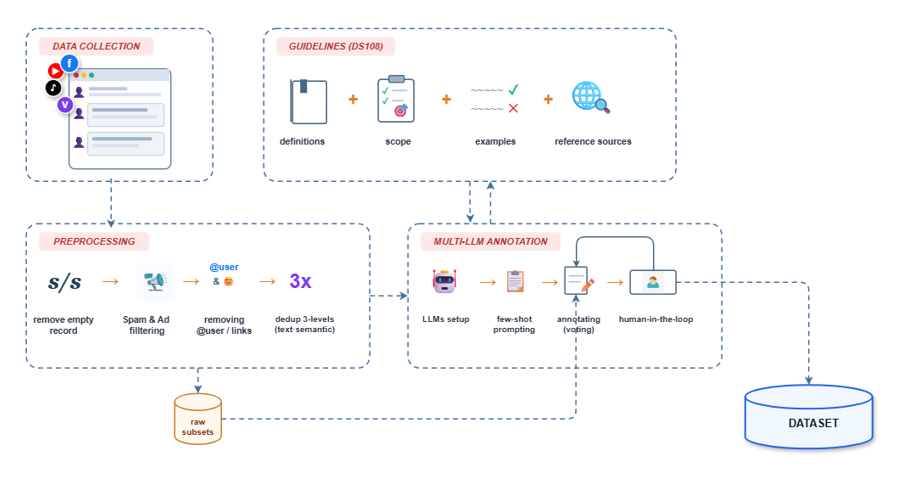
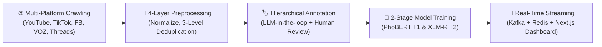

# 🛡️ DS108: Xây Dựng, Tiền Xử Lý Bộ Dữ Liệu Bình Luận Mạng Xã Hội và Thực Nghiệm Hệ Thống Phân Loại Phân Cấp Phát Ngôn Độc Hại Tiếng Việt

<p align="center">
  
</p>

<p align="center">
  <a href="#-giới-thiệu-đề-tài"></a>
  <a href="#-kiến-trúc-dự-án"></a>
  <a href="#-mô-hình--thực-nghiệm"></a>
  <a href="#-mô-hình--thực-nghiệm"></a>
  <a href="#-hệ-thống-kiểm-duyệt-thời-gian-thực-predict-toxic-comments"></a>
</p>

---

## 📖 Giới Thiệu Đề Tài

Phát ngôn độc hại (Hate Speech, Toxic Comments, Cyberbullying) trên các nền tảng mạng xã hội đang là vấn đề nhức nhối ảnh hưởng nghiêm trọng đến môi trường thảo luận trực tuyến. Đồ án môn học **DS108 - Thu thập và Tiền xử lý Dữ liệu** tập trung nghiên cứu toàn diện từ thu thập dữ liệu đa nguồn, làm sạch, gán nhãn bán tự động cho đến xây dựng mô hình AI phân loại phân cấp và ứng dụng vào hệ thống kiểm duyệt trực tiếp:

1. **Thu thập dữ liệu thực tế đa nguồn:** Thu thập bộ dữ liệu chuẩn vàng gồm **48,670 bình luận tiếng Việt** từ 5 nền tảng mạng xã hội phổ biến nhất (Facebook, YouTube, TikTok, VOZ Forum, Threads).
2. **Kiến trúc tiền xử lý 4 tầng bảo toàn ngữ nghĩa:** Quy trình tiền xử lý 4 tầng (*Raw, Interim, Processed, Audit Layer*) kết hợp khử teencode, từ lóng, emoji và hệ thống **khử trùng lặp 3 cấp độ** (chống rò rỉ dữ liệu sang tập kiểm thử với ngưỡng Cosine $\ge 0.90$).
3. **Taxonomy phân loại phân cấp 2 tầng (*Hierarchical 2-stage Taxonomy*):**
   - **Tầng 1 (Toxicity):** `TOXIC` (Độc hại / Công kích) vs `NON-TOXIC` (Bình thường / Hợp lệ).
   - **Tầng 2 (Expression Type - trên tập TOXIC):** `EXPLICIT` (Công kích trực tiếp, thô tục) vs `IMPLICIT` (Công kích gián tiếp, mỉa mai, châm biếm).
4. **Quy trình gán nhãn chuẩn hóa (MAMA & MATTER):** Kết hợp các LLM tiên tiến (`GPT-4o`, `Gemini Flash`, `Qwen`) cùng cơ chế thẩm định chuyên gia với hệ số tin cậy liên thẩm định Fleiss' Kappa toàn cục $\kappa = 0.4931$.
5. **Thực nghiệm mô hình hóa đa kiến trúc:** So sánh đối chuẩn công bằng giữa 4 trường phái mô hình: Deep Learning cổ điển (**TextCNN**), Transformer đơn ngữ (**PhoBERT**, **ViDeBERTa**) và Transformer đa ngữ (**XLM-RoBERTa**).
6. **Hệ thống kiểm duyệt luồng thời gian thực ([`predict-toxic-comments`](./predict-toxic-comments)):** Pipeline xử lý luồng sự kiện tốc độ cao kết hợp Apache Kafka, Redis, Python Consumer (PyTorch), Node.js SSE và Dashboard Next.js 15 theo dõi YouTube Livestream trực tiếp.

---

## 🏛️ Kiến Trúc Hệ Thống (System Pipeline)



---

## 📁 Cấu Trúc Thư Mục Dự Án (Repository Structure)

```text
DS108/
├── Annotation/               # 🏷️ Module Gán nhãn dữ liệu (Taxonomy, Guidelines, LLM Prompts, Scripts)
│   ├── guidelines/           # Hướng dẫn chi tiết cho annotators (tiêu chuẩn nhãn, edge cases)
│   ├── prompts/              # System prompts cho LLM gán nhãn bán tự động
│   ├── schemas/              # JSON Schema ràng buộc nhãn phân cấp
│   └── tools/                # Script tính toán hệ số Fleiss' Kappa
├── Crawler/                  # 🕷️ Module Thu thập dữ liệu từ các nền tảng mạng xã hội
│   ├── scripts/              # Scripts cào YouTube, TikTok, Facebook, VOZ, Threads
│   └── src/                  # Mã nguồn lõi xử lý luồng cào, lưu trữ và chống chặn
├── Dataset/                  # 📦 Bộ dữ liệu sạch chuẩn hóa (gold_standard_final_48670.csv)
├── figures/                  # 📊 Toàn bộ biểu đồ EDA, ma trận nhầm lẫn và biểu đồ đánh giá (DPI 300)
├── Model/                    # 🧠 Module Huấn luyện & Thực nghiệm Mô hình Phân loại (Model_final_v3)
│   ├── artifacts/            # Trọng số checkpoint, training history và metrics từng mô hình
│   ├── report/               # Báo cáo chi tiết Chương 4 Thực nghiệm và Phân tích kết quả
│   ├── results/              # Kết quả Locked Test Set, phân tích độ dài token & ca lỗi định tính
│   └── src/                  # Mã nguồn huấn luyện PhoBERT, XLM-R, ViDeBERTa, TextCNN
├── Preprocessing/            # 🧹 Module Tiền xử lý, Khử trùng lặp & Chuẩn hóa văn bản
│   ├── data/                 # Dữ liệu qua 4 tầng xử lý (raw, interim, processed, audit)
│   ├── docs/                 # Báo cáo kỹ thuật EDA, khử trùng lặp 3 cấp độ và kiểm toán PII
│   └── prompts/              # Từ điển chuẩn hóa teencode và tiếng lóng mạng xã hội
├── predict-toxic-comments/   # 🚀 Hệ thống Kiểm duyệt & Phân tích Bình luận Thời Gian Thực
│   ├── backend/              # Node.js Express + TypeScript (Crawl YouTube Live, SSE, Redis, Mongo)
│   ├── frontend/             # Next.js 15 Dashboard trực quan (Biểu đồ phân cấp, Bộ lọc, Leaderboard)
│   ├── python_consumer/      # Worker suy luận AI phân cấp 2 tầng qua Kafka (PhoBERT & XLM-R)
│   └── model/                # Thư mục chứa checkpoints PyTorch và hướng dẫn cài đặt
├── .env.example              # 🔐 Mẫu cấu hình biến môi trường & API keys
├── .gitignore                # 🚫 Cấu hình loại trừ tệp nhạy cảm & cache khỏi Git
└── requirements.txt          # 📦 Danh sách thư viện phụ thuộc toàn dự án
```

---

## 📊 Kết Quả Thực Nghiệm Đối Chuẩn (Benchmark Highlights)

Được đánh giá nghiêm ngặt trên **Locked Test Set độc lập ($N = 4,867$ mẫu)** theo cấu hình cố định `seed = 42`:

### 1. Tác vụ 1: Phân loại Độc hại (`TOXIC` vs `NON-TOXIC`)
*Mục tiêu: Chốt chặn đầu tiên lọc bỏ các phát ngôn có tính chất công kích, xúc phạm hoặc bôi nhọ.*

| Mô hình | Kiến trúc | Accuracy | Macro Precision | Macro Recall | **Macro F1** | PR-AUC (TOXIC) | Đánh giá |
| :--- | :--- | :---: | :---: | :---: | :---: | :---: | :--- |
| 🥇 **PhoBERT** | RoBERTa-base (Monolingual) | **0.9176** | **0.8129** | 0.7786 | **0.7943** | **0.6943** | **Tốt nhất toàn diện** |
| 🥈 **XLM-R** | RoBERTa-base (Multilingual) | 0.9088 | 0.7841 | **0.7891** | 0.7865 | 0.6819 | Bám sát, Recall cao nhất |
| 🥉 **TextCNN** | 1D-CNN Baseline | 0.8956 | 0.7544 | 0.7308 | 0.7417 | 0.5782 | Baseline vững chắc |
| 4️⃣ **ViDeBERTa** | DeBERTa-base (Disentangled) | 0.7658 | 0.5530 | 0.5782 | 0.5575 | 0.1888 | Kém do nhiễu văn phong MXH |

### 2. Tác vụ 2: Phân loại Kiểu biểu đạt (`EXPLICIT` vs `IMPLICIT` trên tập `TOXIC`)
*Mục tiêu: Phân định giữa công kích trực tiếp (thô tục bề mặt) và công kích gián tiếp (mỉa mai, ẩn dụ, châm biếm).*

| Mô hình | Kiến trúc | Accuracy | Macro Precision | Macro Recall | **Macro F1** | F1 (IMPLICIT) | Đánh giá |
| :--- | :--- | :---: | :---: | :---: | :---: | :---: | :--- |
| 🥇 **XLM-R** | RoBERTa-base (Multilingual) | **0.8379** | **0.6865** | **0.7124** | **0.6978** | **0.4920** | **Tốt nhất Tác vụ 2** |
| 🥈 **PhoBERT** | RoBERTa-base (Monolingual) | 0.8003 | 0.6513 | 0.7097 | 0.6692 | 0.4608 | Độ nhạy cao (Recall 58.14%) |
| 🥉 **TextCNN** | 1D-CNN Baseline | 0.7150 | 0.6004 | 0.6741 | 0.6013 | 0.3883 | Bị precision phạt nặng |
| 4️⃣ **ViDeBERTa** | DeBERTa-base (Disentangled) | 0.8106 | 0.5409 | 0.5231 | 0.5230 | 0.1527 | Kém hiệu quả trên ẩn ý |

> 📄 *Xem toàn bộ biểu đồ phân tích độ dài token, ma trận nhầm lẫn và phân tích ca lỗi tại [Chương 4 Báo Cáo Thực Nghiệm](./Model/report/chuong_4_thuc_nghiem_va_phan_tich_ket_qua.md).*

---

## 🚀 Hướng Dẫn Cài Đặt & Sử Dụng Từng Phân Hệ

### 1. Chuẩn bị Môi trường Chung
Yêu cầu: **Python >= 3.10** (Khuyến nghị **Python 3.11**) và **Node.js >= 18**.

```bash
# Clone dự án
git clone https://github.com/your-username/DS108.git
cd DS108

# Thiết lập môi trường ảo Python
python -m venv .venv
# Windows:
.venv\Scripts\Activate.ps1
# Linux/macOS:
source .venv/bin/activate

# Cài đặt thư viện
pip install -r requirements.txt
```

---

### 2. Tiền Xử Lý Dữ Liệu ([`Preprocessing/`](./Preprocessing))
Quy trình làm sạch, chuẩn hóa teencode và khử trùng lặp 3 cấp độ:
```bash
cd Preprocessing
# Chạy notebook hoặc scripts làm sạch
jupyter notebook notebooks/02_clearing_data.ipynb
```

---

### 3. Huấn Luyện & Đánh Giá Mô Hình ([`Model/`](./Model))
Huấn luyện các mô hình trên tập dữ liệu chuẩn vàng 48,670 mẫu:
```bash
cd Model

# Huấn luyện Tác vụ 1 (PhoBERT)
python src/train.py --model phobert --task task1 --batch_size 16 --lr 2e-5

# Huấn luyện Tác vụ 2 (XLM-R)
python src/train.py --model xlmr --task task2 --batch_size 16 --lr 2e-5
```

---

### 4. Vận Hành Hệ Thống Kiểm Duyệt Real-Time ([`predict-toxic-comments/`](./predict-toxic-comments))

Hệ thống cho phép giám sát và phân loại bình luận phát sóng trực tiếp trên YouTube theo thời gian thực:

#### Bước 1: Khởi động Hạ tầng (Kafka, Redis, Python Consumer)
```bash
cd predict-toxic-comments
docker compose -f docker-compose-light.yml up -d
```

#### Bước 2: Khởi chạy Backend Service (Node.js API & SSE)
```bash
cd predict-toxic-comments/backend
npm install
npm run dev
```

#### Bước 3: Khởi chạy Frontend Dashboard (Next.js 15)
```bash
cd predict-toxic-comments/frontend
npm install
npm run dev
```

Truy cập giao diện tại **`http://localhost:3000`**, nhập link YouTube Livestream để xem luồng phân loại và gợi ý hành động (`Ban`, `Hide`, `Pending`, `Safe`) tức thì.

---

## 👥 Nhóm Tác Giả & Hướng Dẫn

- **Môn học:** DS108 - Thu thập và Tiền xử lý Dữ liệu
- **Đơn vị đào tạo:** Khoa Khoa học và Kỹ thuật Thông tin - Trường Đại học Công nghệ Thông tin - ĐHQG TP.HCM (UIT - VNUHCM)
- **Sinh viên thực hiện:**
  - Nguyễn Hoàng Phúc (25550018)
  - Dương Tùng Dương (25550006)

---

## 📜 Giấy Phép & Tuyên Bố Miễn Trừ Trách Nhiệm (Disclaimer)
- Dự án được phát triển phục vụ mục đích **nghiên cứu khoa học và học thuật**.
- Dữ liệu thu thập từ các bình luận công khai trên mạng xã hội nhằm phục vụ bài toán nhận diện và ngăn chặn phát ngôn độc hại; nhóm tác giả không cổ súy, tán đồng hay truyền bá bất kỳ nội dung tiêu cực nào xuất hiện trong tập ngữ liệu nghiên cứu.
