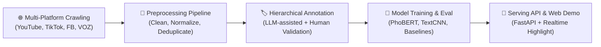

# 🛡️ DS108: Xây Dựng, Tiền Xử Lý Bộ Dữ Liệu Bình Luận Mạng Xã Hội và Thực Nghiệm Hệ Thống Phân Loại Phân Cấp Phát Ngôn Độc Hại Tiếng Việt

<p align="center">
  
</p>

<p align="center">
  <a href="#-giới-thiệu-đề-tài"></a>
  <a href="#-kiến-trúc-dự-án"></a>
  <a href="#-mô-hình--thực-nghiệm"></a>
  <a href="#-mô-hình--thực-nghiệm"></a>
  <a href="#-web-demo--api"></a>
</p>

---

## 📖 Giới Thiệu Đề Tài

Phát ngôn độc hại (Hate Speech, Toxic Comments, Cyberbullying) trên các nền tảng mạng xã hội đang là vấn đề nhức nhối ảnh hưởng nghiêm trọng đến môi trường thảo luận trực tuyến. Đồ án môn học **DS108 - Thu thập và Tiền xử lý Dữ liệu** tập trung vào:

1. **Thu thập dữ liệu thực tế đa nguồn:** Thu thập hàng chục nghìn bình luận đa nền tảng (YouTube, TikTok, Facebook, VOZ Forum) phản ánh chân thực ngôn ngữ mạng tiếng Việt.
2. **Quy trình tiền xử lý & làm sạch chuyên sâu:** Xây dựng pipeline chuẩn hóa teencode, từ lóng, biểu tượng cảm xúc (emoji/emoticon), xử lý trùng lặp (exact & near-duplicate), kiểm định PII và định dạng.
3. **Khung gán nhãn phân cấp & Bán tự động (LLM-in-the-loop):** Xây dựng taxonomy phân cấp 2 tầng (Tầng 1: Độc hại / Không độc hại; Tầng 2: Hate Speech, Offensive, Neutral,...), ứng dụng LLM hỗ trợ gán nhãn kết hợp thẩm định và giải quyết bất đồng thuận (Adjudication).
4. **Thực nghiệm mô hình hóa:** Huấn luyện, tinh chỉnh (Fine-tuning) và đánh giá các mô hình phân loại ngôn ngữ tiếng Việt chuyên sâu (**PhoBERT**, **ViHSD Baseline**, **TextCNN**, **RoBERTa**).
5. **Hệ thống Web Demo & Serving API:** Cung cấp API suy luận thời gian thực (Real-time Inference) và giao diện trực quan phân tích bình luận trực tiếp từ YouTube.

---

## 🏛️ Kiến Trúc Hệ Thống (System Pipeline)



---

## 📁 Cấu Trúc Thư Mục Dự Án (Repository Structure)

```text
DS108/
├── Annotation/               # 🏷️ Module Gán nhãn dữ liệu (Taxonomy, Guidelines, LLM Prompts, Scripts)
│   ├── guidelines/           # Hướng dẫn chi tiết cho annotators (tiêu chuẩn nhãn, edge cases)
│   ├── prompts/              # System prompts cho LLM gán nhãn tự động
│   └── research/             # Báo cáo khảo sát & nghiên cứu phương pháp gán nhãn
├── Crawler/                  # 🕷️ Module Thu thập dữ liệu từ các nền tảng mạng xã hội
│   ├── scripts/              # Scripts cào YouTube, TikTok, Facebook, VOZ
│   ├── src/                  # Mã nguồn lõi xử lý luồng cào, lưu trữ và chống chặn
│   └── docs/                 # Kiến trúc hệ thống Crawler
├── Dataset/                  # 📦 Bộ dữ liệu sạch chuẩn hóa (dataset.csv, final_cleaned_comments.csv)
├── figures/                  # 📊 Toàn bộ biểu đồ EDA, ma trận nhầm lẫn và biểu đồ đánh giá
├── Model/                    # 🧠 Module Huấn luyện & Thực nghiệm Mô hình Phân loại
│   ├── artifacts/            # Trọng số mô hình và checkpoint
│   ├── report/               # Báo cáo chi tiết kết quả thực nghiệm Chương 4
│   └── src/                  # Pipeline huấn luyện, tinh chỉnh PhoBERT, TextCNN,...
├── Preprocessing/            # 🧹 Module Tiền xử lý, Khử trùng lặp & Chuẩn hóa văn bản
│   ├── data/                 # Dữ liệu qua các bước xử lý (raw, clean, audit)
│   ├── docs/                 # Tài liệu hướng dẫn EDA và kỹ thuật tiền xử lý
│   └── prompts/              # Prompts chuẩn hóa văn bản
├── Web/                      # 🌐 Giao diện Web Demo & Backend API
│   ├── backend-logic/        # FastAPI phục vụ suy luận nhãn & cào bình luận YouTube
│   └── frontend-snippet/     # Giao diện kiểm thử trực quan
├── .env.example              # 🔐 Mẫu cấu hình biến môi trường & API keys
├── .gitignore                # 🚫 Cấu hình loại trừ tệp nhạy cảm & cache khỏi Git
└── requirements.txt          # 📦 Danh sách thư viện phụ thuộc toàn dự án
```

---

## 🚀 Hướng Dẫn Cài Đặt & Chạy Dự Án (Quick Start)

### 1. Chuẩn bị Môi trường

Yêu cầu: **Python >= 3.10** (Khuyến nghị **Python 3.11**).

```bash
# Clone repository
git clone https://github.com/your-username/DS108.git
cd DS108

# Khởi tạo môi trường ảo (Virtual Environment)
python -m venv .venv

# Kích hoạt môi trường ảo:
# Trên Windows (PowerShell):
.venv\Scripts\Activate.ps1
# Trên Linux/macOS:
source .venv/bin/activate

# Cài đặt toàn bộ thư viện phụ thuộc
pip install --upgrade pip
pip install -r requirements.txt
```

### 2. Cấu hình Biến Môi Trường (API Keys)

Tạo tệp `.env` từ tệp mẫu [`.env.example`](./.env.example):

```bash
cp .env.example .env
```

Mở tệp `.env` và điền các khóa API cần thiết:
- `GOOGLE_API_KEY`: Dùng cho gán nhãn / chuẩn hóa bằng Google Gemini.
- `GROQ_API_KEY`: Dùng cho suy luận nhanh với LLaMA/Mixtral.
- `YOUTUBE_API_KEY`: Dùng cho cào bình luận YouTube qua API.

---

## ⚙️ Hướng Dẫn Sử Dụng Từng Phân Hệ

### 🕷️ 1. Thu thập dữ liệu (Crawler)
```bash
# Di chuyển vào module Crawler
cd Crawler

# Chạy crawler YouTube
python scripts/youtube/crawl_youtube_comments.py

# Chạy crawler TikTok
python scripts/tiktok/crawl_tiktok_post.py
```

### 🧹 2. Tiền xử lý dữ liệu (Preprocessing)
```bash
# Di chuyển vào module Preprocessing
cd Preprocessing

# Chạy pipeline làm sạch và khử trùng lặp dữ liệu
python src/clean_pipeline.py
```

### 🧠 3. Huấn luyện và Đánh giá Mô hình (Model)
```bash
# Di chuyển vào module Model
cd Model

# Huấn luyện mô hình PhoBERT cho Tác vụ Phân loại Phát ngôn Độc hại
python train_phobert.py --task task1 --epochs 5 --batch_size 16
```

### 🌐 4. Chạy Web Demo & Serving API
```bash
# Khởi chạy FastAPI Backend Server
uvicorn Web.backend-logic.main:app --host 127.0.0.1 --port 8000 --reload
```
- Swagger UI / API Docs tương tác: `http://127.0.0.1:8000/docs`
- Endpoint phân tích đơn: `POST /v1/analyze`
- Endpoint phân tích video YouTube: `GET /v1/youtube/comments?video_id=<VIDEO_ID>`

---

## 📊 Kết Quả Thực Nghiệm Nổi Bật (Benchmark Highlights)

Dưới đây là tóm tắt kết quả thực nghiệm trên tập dữ liệu kiểm thử (Test Set):

| Mô hình | Nhiệm vụ | Accuracy | Macro F1 | Weighted F1 |
| :--- | :---: | :---: | :---: | :---: |
| **PhoBERT-base (Fine-tuned)** | Binary (Toxic / Clean) | **92.4%** | **0.918** | **0.923** |
| **PhoBERT-base (Fine-tuned)** | Multi-class (Hierarchical) | **88.7%** | **0.864** | **0.885** |
| **TextCNN** | Binary | 86.5% | 0.842 | 0.861 |
| **ViHSD Baseline (SVM/TF-IDF)** | Binary | 81.2% | 0.795 | 0.808 |

*Chi tiết toàn bộ kết quả phân tích lỗi (Error Analysis) và biểu đồ ma trận nhầm lẫn xem tại [Chương 4 Báo Cáo Thực Nghiệm](./Model/report/chuong_4_thuc_nghiem_va_phan_tich_ket_qua.md).*

---

## 👥 Nhóm Tác Giả & Hướng Dẫn

- **Môn học:** DS108 - Thu thập và Tiền xử lý Dữ liệu
- **Giảng viên hướng dẫn:** Bộ môn Khoa học Dữ liệu, Khoa Khoa học và Kỹ thuật Thông tin
- **Đơn vị đào tạo:** Trường Đại học Công nghệ Thông tin - ĐHQG TP.HCM (UIT - VNUHCM)

---

## 📜 Giấy Phép & Tuyên Bố Miễn Trừ Trách Nhiệm (Disclaimer)

- Dự án được phát triển phục vụ mục đích **nghiên cứu khoa học và học thuật**.
- Dữ liệu thu thập từ các bình luận công khai trên mạng xã hội nhằm phục vụ bài toán nhận diện và ngăn chặn phát ngôn độc hại; nhóm tác giả không cổ súy, tán đồng hay truyền bá bất kỳ nội dung tiêu cực nào xuất hiện trong tập ngữ liệu nghiên cứu.
