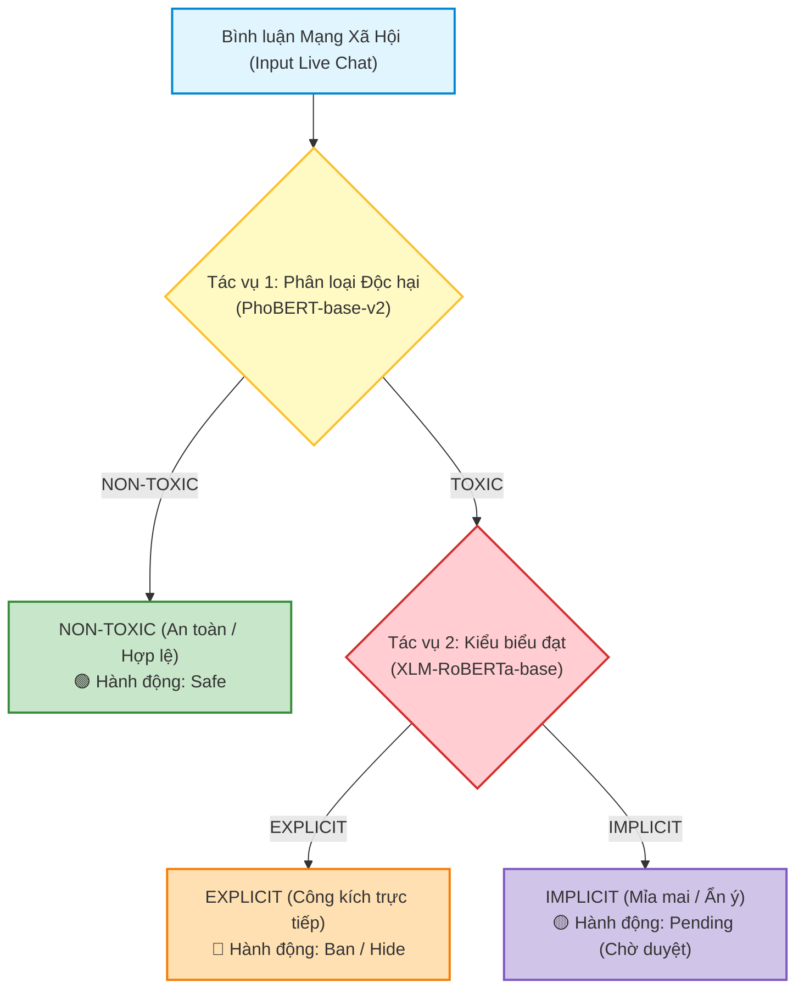
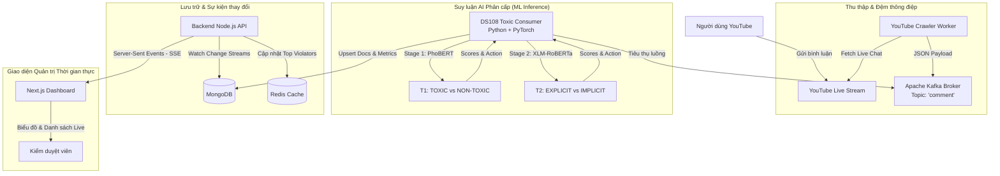

# Hệ thống Phân Loại Phân Cấp Phát Ngôn Độc Hại Thời Gian Thực (DS108 Real-Time StreamGuard)

---

## 1. 📌 Giới thiệu Đề tài
Hệ thống **DS108 Real-Time StreamGuard** là giải pháp phân tích và kiểm duyệt bình luận phát trực tiếp (YouTube Live Chat) theo thời gian thực, áp dụng kiến trúc **Phân loại Phân cấp 2 tầng (*Hierarchical 2-stage Toxic Language Detection*)** dựa trên kết quả nghiên cứu và thực nghiệm của đề tài **DS108**:



---

## 2. 🧠 Các Mô Hình Xuất Sắc Nhất Của Dự Án

Toàn bộ hệ thống suy luận được xây dựng dựa trên kết quả thực nghiệm chuẩn mực trên **Locked Test Set (4,867 mẫu)** của tập dữ liệu chuẩn vàng 48,670 bình luận:

1. **Tác vụ 1: Phân loại Độc hại (`TOXIC` vs `NON-TOXIC`)**
   - 🥇 **Mô hình tốt nhất:** **PhoBERT** (`vinai/phobert-base-v2`)
   - **Chỉ số:** **Macro-F1 = `0.7943`**, **Accuracy = `91.76%`**, **PR-AUC = `0.6943`**.
   - **Ưu thế:** Tách từ âm tiết ghép tiếng Việt (`PyVi`) kết hợp 20GB ngữ liệu tiền huấn luyện thuần Việt, bắt trọn các cụm từ xúc phạm đặc thù.

2. **Tác vụ 2: Phân loại Kiểu biểu đạt (`EXPLICIT` vs `IMPLICIT` trên tập `TOXIC`)**
   - 🥇 **Mô hình tốt nhất:** **XLM-RoBERTa** (`FacebookAI/xlm-roberta-base`)
   - **Chỉ số:** **Macro-F1 = `0.6978`**, **Accuracy = `83.79%`**, **F1 (IMPLICIT) = `0.4920`**.
   - **Ưu thế:** Bộ từ điển SentencePiece lớn (250K subwords) và không gian embedding đa ngữ giúp khái quát hóa rất tốt các dạng câu mỉa mai (*sarcasm*), nói lái, khen đểu và biến thể teencode.

---

## 3. 🎯 Cơ Chế Quyết Định Hành Động (`recommended_action`)

Hệ thống tự động hóa công tác điều hành phòng chat theo các ngưỡng khuyến nghị trong báo cáo nghiên cứu:
- ⛔ **`Ban` (Cấm vĩnh viễn):** Dành cho phát ngôn `TOXIC - EXPLICIT` có độ tin cậy cao (`toxic_score >= 0.85`), chứa từ ngữ lăng mạ hoặc đe dọa thô bạo.
- 👁️ **`Hide` (Ẩn nội dung):** Dành cho phát ngôn `TOXIC` đạt ngưỡng (`toxic_score >= 0.70`).
- ⏳ **`Pending` (Gắn cờ Chờ duyệt):** Dành cho phát ngôn `TOXIC - IMPLICIT` (mỉa mai, ẩn ý đòi hỏi kiểm duyệt viên con người xác thực) hoặc phát ngôn nghi vấn trong khoảng điểm `[0.50, 0.70)`.
- 🟢 **`Safe` (Hợp lệ):** Dành cho phát ngôn `NON-TOXIC` (`toxic_score < 0.50`).

---

## 4. 🏗 Kiến Trúc Kỹ Thuật (System Architecture)



---

## 5. 📂 Cấu Trúc Thư Mục Phân Hệ

```text
predict-toxic-comments/
├── backend/                 # Node.js Express + TypeScript (Crawl YouTube, SSE, MongoDB, Redis)
├── frontend/                # Next.js 15 Dashboard (Biểu đồ phân cấp, Realtime stream, Leaderboard)
├── python_consumer/         # Python Consumer tiêu thụ Kafka & suy luận mô hình phân cấp 2 tầng
├── model/                   # Thư mục chứa checkpoints .pt (PhoBERT, XLM-R) & tài liệu
├── docker-compose-light.yml # Bản Docker Compose tối ưu RAM (1 Kafka + Redis + Consumer)
├── docker-compose.yml       # Bản Docker Compose cụm đầy đủ
└── README.md                # Tài liệu hướng dẫn chi tiết
```

---

## 6. 🚀 Hướng Dẫn Cài Đặt & Chạy Hệ Thống

### Bước 1: Khởi động Hạ tầng (Kafka, Redis, Python Consumer)

Khuyến khích sử dụng tệp `docker-compose-light.yml` (chạy mượt mà trên máy tính cá nhân):

```bash
cd predict-toxic-comments
docker compose -f docker-compose-light.yml up -d
```

> [!NOTE]
> - Nếu bạn đã có checkpoint huấn luyện `.pt`, hãy đặt vào `model/phobert_task1.pt` và `model/xlmr_task2.pt`.
> - Nếu chưa nạp file checkpoint, `consumer.py` sẽ **tự động kích hoạt bộ Heuristic chuẩn DS108** để kiểm thử ngay lập tức mà không gặp bất kỳ lỗi gián đoạn nào.

### Bước 2: Khởi động Backend API

1. Mở terminal mới:
   ```bash
   cd predict-toxic-comments/backend
   npm install
   ```
2. Cấu hình tệp `.env` (copy từ `.env_example`):
   - `YOUTUBE_API_KEY`: API Key YouTube Data v3.
   - `MONGO_URI`: Địa chỉ MongoDB (ví dụ: `mongodb://localhost:27017`).
   - `KAFKA_BOOTSTRAP_SERVER`: `localhost:9092`.
3. Chạy backend:
   ```bash
   npm run dev
   ```
   *Backend chạy tại: `http://localhost:5000` (hoặc cổng cấu hình).*

### Bước 3: Khởi động Frontend Dashboard

1. Mở terminal mới:
   ```bash
   cd predict-toxic-comments/frontend
   npm install
   npm run dev
   ```
2. Mở trình duyệt tại: **`http://localhost:3000`**.

### Bước 4: Kiểm thử Theo dõi Livestream

1. Dán đường dẫn một video hoặc Livestream YouTube bất kỳ vào ô tìm kiếm:
   *(Ví dụ: `https://www.youtube.com/watch?v=...`)*
2. Bấm **Bắt đầu theo dõi**.
3. Dashboard sẽ tự động:
   - Thu thập luồng bình luận trực tiếp.
   - Hiển thị nhãn phân cấp: `TOXIC` / `NON-TOXIC`, `EXPLICIT` (Trực tiếp) vs `IMPLICIT` (Mỉa mai).
   - Đưa ra hành vi xử phạt: `Ban`, `Hide`, `Pending`, `Safe`.
   - Cập nhật biểu đồ xu hướng độc hại và bảng xếp hạng người dùng vi phạm theo từng phút phát sóng.

---

## 🤝 Đóng góp & Bản quyền
Dự án trực thuộc Đồ án môn học **DS108 - Thu thập và Tiền xử lý Dữ liệu**, Trường Đại học Công nghệ Thông tin - ĐHQG TP.HCM (UIT - VNUHCM).
