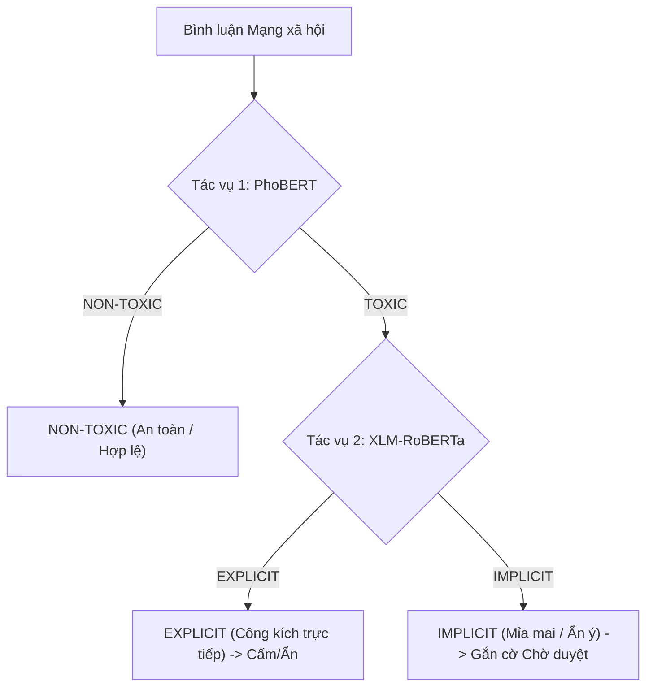

# Hướng dẫn Thiết lập Checkpoint Mô hình AI (DS108)

Hệ thống phân tích bình luận thời gian thực sử dụng kiến trúc **Phân loại Phân cấp 2 tầng (Hierarchical 2-stage Classification)** theo đúng nghiên cứu của đề tài **DS108**:



---

## 🧠 Thông tin Mô hình

1. **Tác vụ 1: Phân loại Độc hại (`TOXIC` vs `NON-TOXIC`)**
   - **Mô hình xuất sắc nhất:** **PhoBERT** (`vinai/phobert-base-v2`)
   - **Hiệu năng kiểm thử (Locked Test Set):** Macro-F1 = `0.7943`, Accuracy = `91.76%`, PR-AUC = `0.6943`.
   - **Tên file checkpoint khuyến nghị:** `phobert_task1.pt`

2. **Tác vụ 2: Phân loại Kiểu biểu đạt (`EXPLICIT` vs `IMPLICIT`)**
   - **Mô hình xuất sắc nhất:** **XLM-RoBERTa** (`FacebookAI/xlm-roberta-base`)
   - **Hiệu năng kiểm thử (Locked Test Set):** Macro-F1 = `0.6978`, Accuracy = `83.79%`, F1 (IMPLICIT) = `0.4920`.
   - **Tên file checkpoint khuyến nghị:** `xlmr_task2.pt`

---

## 📂 Cách thiết đặt Checkpoint

1. Sau khi huấn luyện từ module `Model/` hoặc tải checkpoint, đặt các tệp `.pt` vào thư mục này:
   ```text
   predict-toxic-comments/model/
   ├── README.md
   ├── phobert_task1.pt      # Checkpoint Tác vụ 1 (PhoBERT)
   └── xlmr_task2.pt         # Checkpoint Tác vụ 2 (XLM-R)
   ```

2. **Cơ chế Dự phòng (Heuristic Fallback):**
   - Nếu bạn chưa nạp file trọng số `.pt`, hệ thống sẽ **tự động chuyển sang chế độ phân tích quy tắc chuyên sâu (DS108 Linguistic Heuristic Engine)** dựa trên bộ từ điển và mẫu câu nghiên cứu thực tế. Toàn bộ quy trình phân cấp 2 tầng và gợi ý hành động (`Ban`, `Hide`, `Pending`, `Safe`) vẫn vận hành mượt mà thời gian thực.
